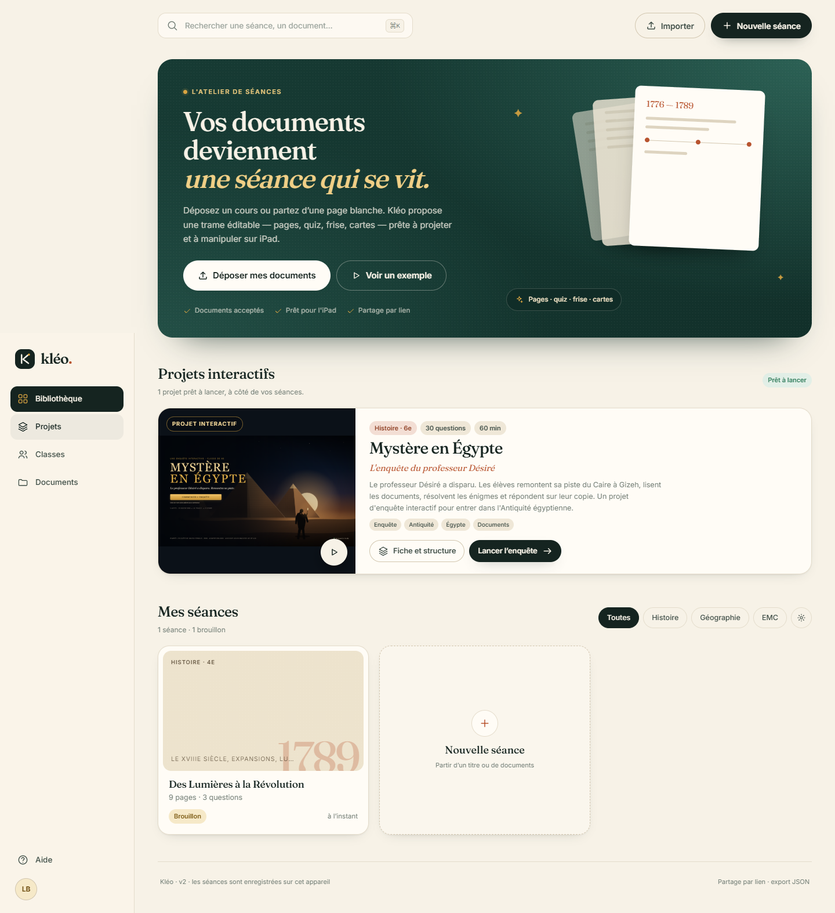
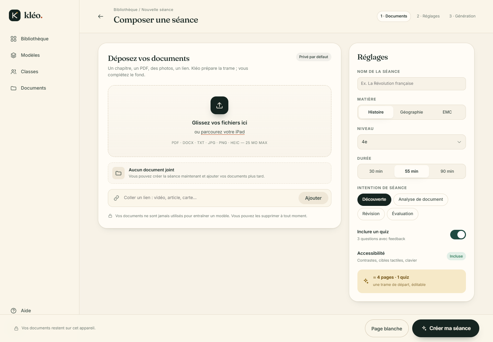
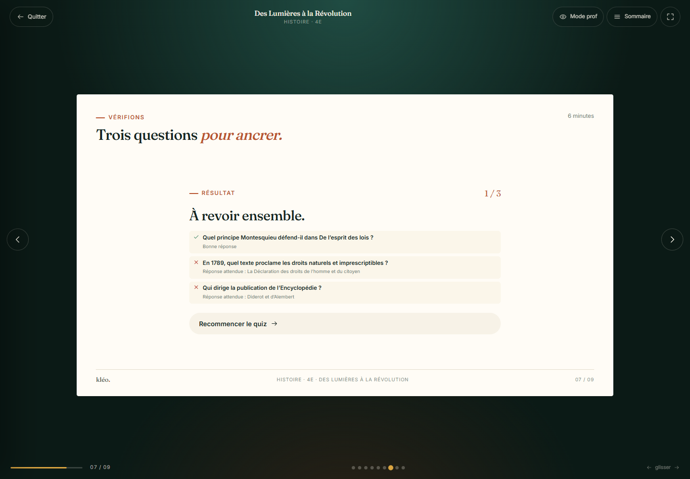
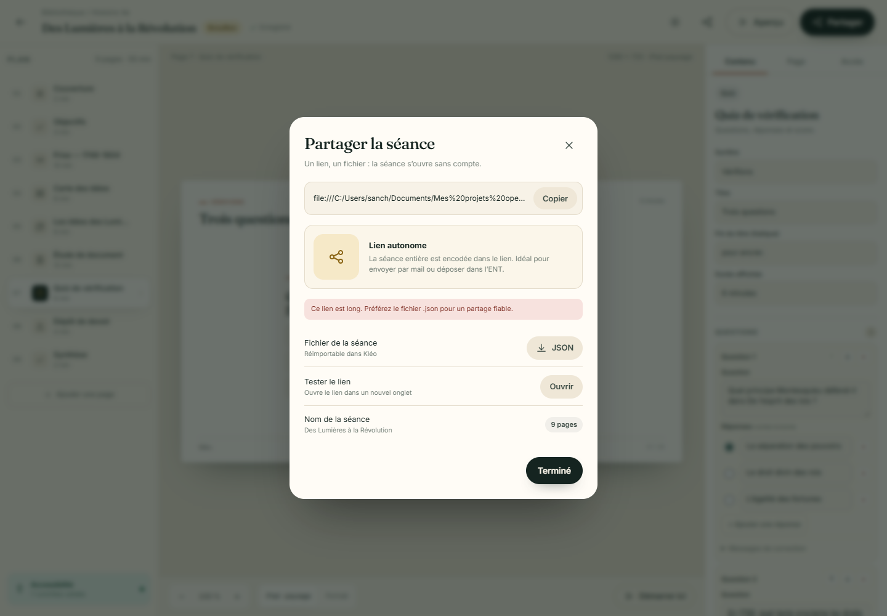

# Kléo — la fabrique de séances

> **Nom de travail.** Remplacer « Kléo » par le nom définitif se fait en une passe (`grep -ri kleo`).

Kléo transforme un cours en **séance interactive** : pages, frise, carte, cartes à retourner, étude de document, quiz noté, dépôt de devoir. Le tout se crée dans le navigateur, s'enregistre sur l'appareil et se partage par lien. Prévu pour être projeté et manipulé sur iPad.

**Version en ligne : [louskyfly.github.io/kleo](https://louskyfly.github.io/kleo/)**

## Ce qui fonctionne en v2

- **Bibliothèque réelle** : créer, dupliquer, renommer, supprimer, filtrer, importer et exporter des séances.
- **Éditeur fonctionnel** : 9 types de pages, formulaires de contenu, réorganisation, duplication et suppression.
- **Constructeur de quiz** : questions, réponses, bonne réponse, messages de correction, vrai/faux, aperçu immédiat.
- **Mode séance** : score, correction question par question, sommaire, notes du professeur, minuteur, clavier et tactile.
- **Enregistrement local** automatique (localStorage), avec indicateur « Enregistré ».
- **Partage** : lien autonome contenant la séance, export/import `.json`.
- **iPad** : tiroir d'édition tactile, cibles ≥ 44 px, glissement entre les pages.

## Aperçu

| Bibliothèque | Éditeur et constructeur de quiz |
| --- | --- |
|  |  |

| Quiz joué sur iPad | Import et réglages |
| --- | --- |
|  |  |

| Résultat du quiz | Partage |
| --- | --- |
|  |  |

## Utiliser Kléo

1. **Créer** une séance : titre, matière, niveau, durée, quiz initial.
2. **Ouvrir l'éditeur** et choisir une page dans le plan.
3. **Modifier** le contenu dans le panneau de droite (ou le tiroir « Éditer » sur iPad).
4. **Ajouter une page** : frise, carte, cartes, document, quiz, dépôt, synthèse.
5. **Aperçu** : jouer la séance, répondre au quiz, voir le score.
6. **Partager** : copier le lien ou télécharger le fichier `.json`.

Raccourcis : `←` `→` dans le mode séance, `Échap` pour fermer, `Ctrl/⌘ + S` pour enregistrer, `Ctrl/⌘ + K` pour la recherche.

## En local

Aucune installation :

```bash
npx serve app
```

Puis ouvrir l'URL affichée. Le dossier `app/` fonctionne aussi en double-cliquant sur `index.html`.

## Structure

```
app/                    application v2 (aucune dépendance)
  data.js               modèle, contenu de démonstration, stockage
  slides.js             rendu des pages
  editor.js             formulaires et constructeur de quiz
  app.js                bibliothèque, éditeur, mode séance, partage
  styles.css            design system et pages
  v2.css                édition, tiroirs, formulaires
  assets/europe.svg     fond de carte (Natural Earth, domaine public)
mockup/                 maquette v1 conservée pour référence
docs/
  RECHERCHE-genially.md analyse du site de référence
  PRODUIT.md            spécification, pipeline IA, roadmap
  previews/             captures des versions
```

## Déploiement

La version en ligne est publiée depuis la branche **`gh-pages`**, qui contient le dossier `app/`. Après une modification :

```bash
git subtree split --prefix app -b gh-pages-deploy
git push origin gh-pages-deploy:gh-pages --force
git branch -D gh-pages-deploy
```

## Limites assumées de la v2

- **Tout est local** : les séances vivent dans le navigateur de l'appareil. Pas encore de compte ni de synchronisation.
- **Pas encore d'IA** : les documents sont joints à la séance, mais Kléo ne les analyse pas. La trame est un point de départ à compléter.
- **Lien de partage** : la séance entière est encodée dans l'URL. Elle peut être longue ; pour un partage fiable, préférer le fichier `.json`.
- **Dépôt de devoir simulé** : l'élève peut choisir un fichier, rien n'est envoyé à un serveur.
- **Pas d'export PDF/SCORM** pour l'instant.

## Prochaines étapes

1. Backend (comptes, stockage, synchronisation) et vrai partage par identifiant court.
2. Import PDF/DOCX et extraction de texte, puis structuration assistée (LLM → plan JSON).
3. Dépôt de copies côté élève et suivi des résultats.
4. Export PDF/SCORM, mode présentation en direct.
5. Tests en classe sur iPad et audit d'accessibilité complet.

## Licence

Projet privé — tous droits réservés.
