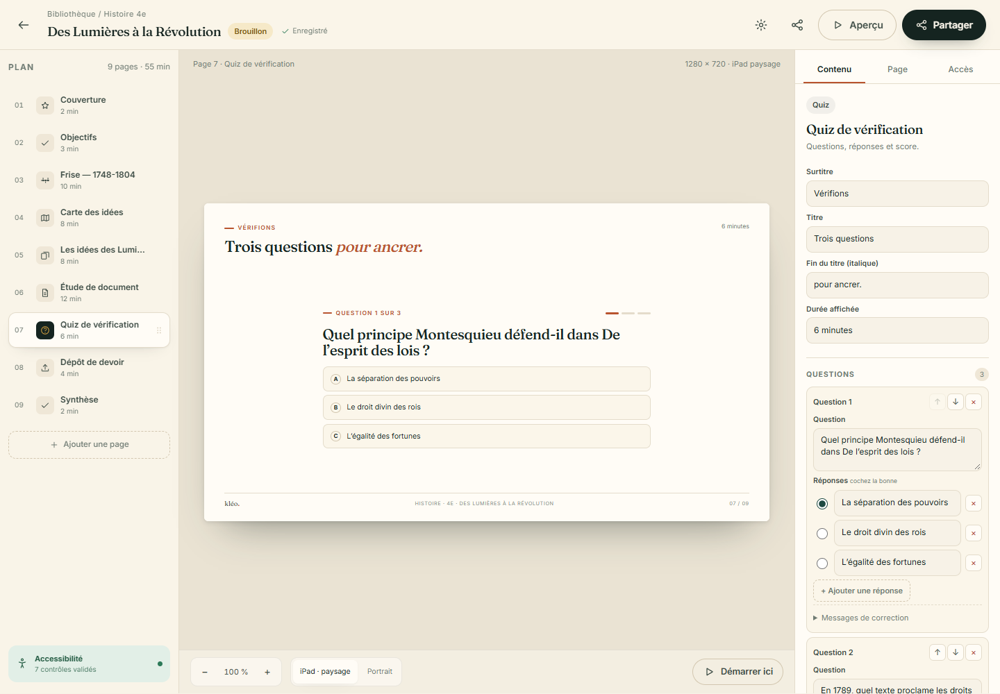
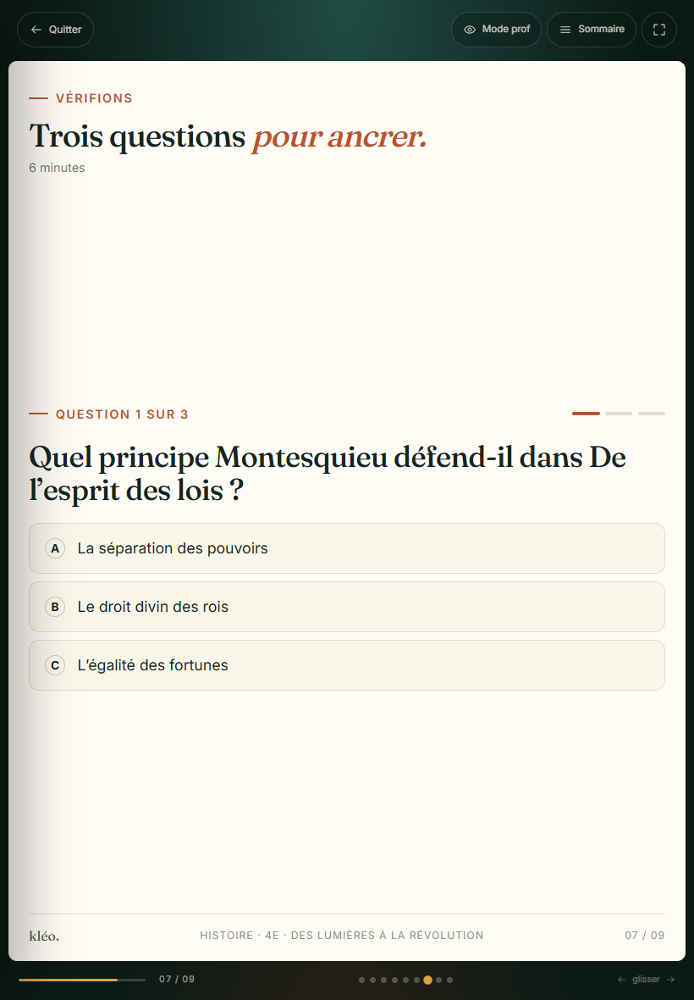
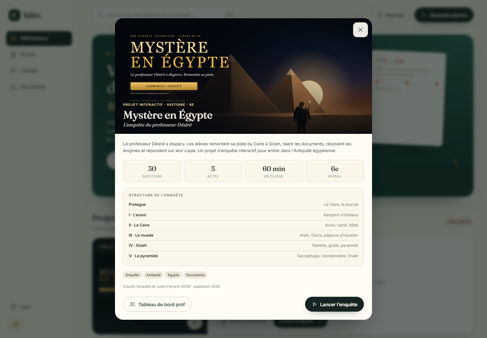
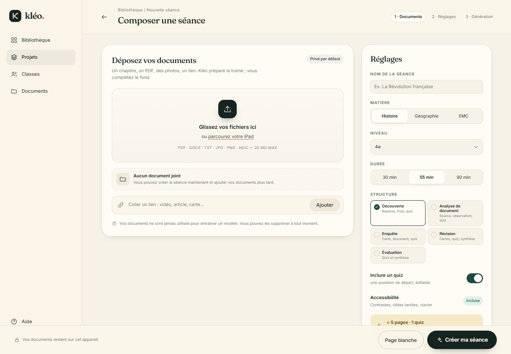
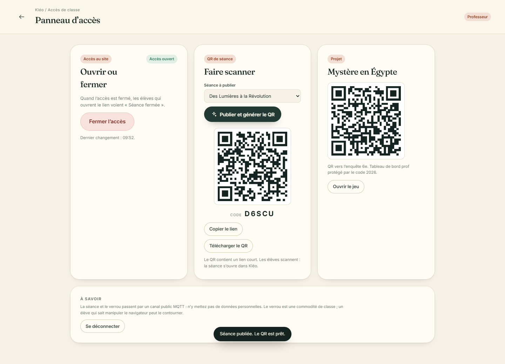
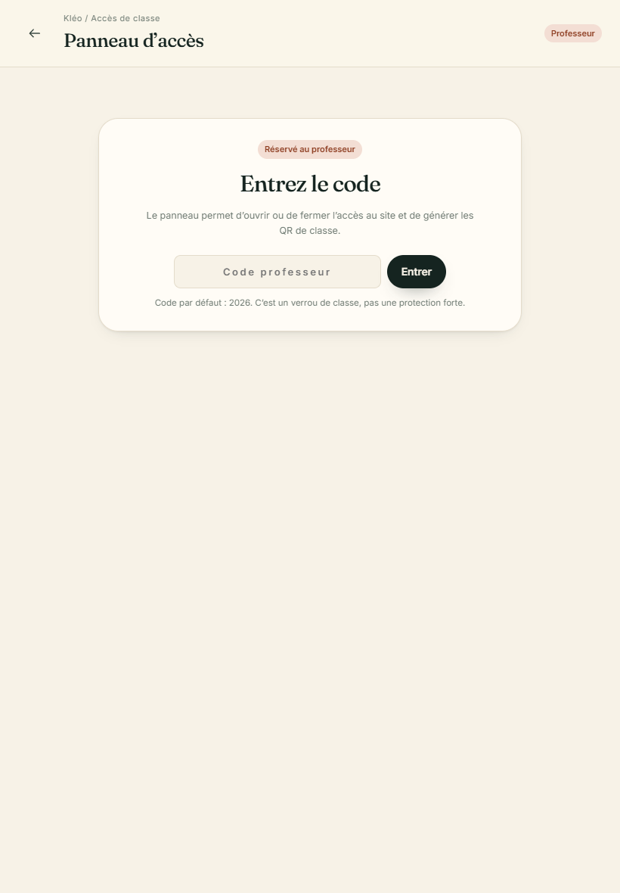

# Kléo — la fabrique de séances

> **Mode bibliothèque (actuel).** L'interface ne montre plus que la bibliothèque des expériences : *Mystère en Égypte* (6e) et *URSS de Staline / Allemagne nazie* (3e). Un clic ouvre l'expérience, sans fiche intermédiaire. L'atelier (import, génération, éditeur, séances) est **masqué, pas supprimé** : il suffit de passer `LIBRARY_ONLY` à `false` en haut de `app/app.js` pour le réafficher.

> **Nom de travail.** Remplacer « Kléo » par le nom définitif se fait en une passe (`grep -ri kleo`).

Kléo transforme un cours en **séance interactive** : pages, frise, carte, cartes à retourner, étude de document, quiz noté, dépôt de devoir. Le tout se crée dans le navigateur, s'enregistre sur l'appareil et se partage par lien. Prévu pour être projeté et manipulé sur iPad.

**Version en ligne : [louskyfly.github.io/kleo](https://louskyfly.github.io/kleo/)**

## Ce qui fonctionne en v2

- **Bibliothèque réelle** : créer, dupliquer, renommer, supprimer, filtrer, importer et exporter des séances.
- **Projets invités** : « Mystère en Égypte » (6e), fiche, structure en 5 actes et lancement de l'enquête.
- **Structures de séance** : découverte, analyse de document, enquête, révision, évaluation, page blanche.
- **Classe et QR** : panneau professeur, ouverture/fermeture de l'accès au site, QR de séance et QR du projet.
- **Éditeur fonctionnel** : 9 types de pages, formulaires de contenu, réorganisation, duplication et suppression.
- **Constructeur de quiz** : questions, réponses, bonne réponse, messages de correction, vrai/faux, aperçu immédiat.
- **Mode séance** : score, correction question par question, sommaire, notes du professeur, minuteur, clavier et tactile.
- **Enregistrement local** automatique (localStorage), avec indicateur « Enregistré ».
- **Partage** : lien autonome contenant la séance, export/import `.json`.
- **iPad** : tiroir d'édition tactile, cibles ≥ 44 px, glissement entre les pages.

## Aperçu

| Bibliothèque | Éditeur et constructeur de quiz |
| --- | --- |
|  |  |

| Quiz joué sur iPad | Import et réglages |
| --- | --- |
|  |  |

| Résultat du quiz | Partage |
| --- | --- |
|  |  |

| Projet invité : Mystère en Égypte | Structures de séance |
| --- | --- |
|  |  |

| Panneau d'accès et QR | Écran élève quand l'accès est fermé |
| --- | --- |
|  |  |

## Classe, QR et verrou

Le panneau d'accès est accessible par le lien **« Panneau »** de la barre latérale, par le pied de page, ou par **« Je suis le professeur »** sur l'écran de blocage. Code par défaut : **2026**.

- **Ouvrir / fermer l'accès** : quand il est fermé, tous les élèves qui ouvrent le site voient « Séance fermée ».
- **Publier une séance** : choisissez la séance, cliquez sur « Publier et générer le QR ». Le QR contient un lien court (`#/join/CODE`) ; les élèves scannent et la séance s'ouvre.
- **QR du projet** : un QR prêt à scanner vers « Mystère en Égypte ».
- **Télécharger le QR** : pour l'imprimer ou le projeter.

La séance et le verrou passent par un broker MQTT public : internet est nécessaire. C'est un **verrou de classe**, pas une protection forte, et il ne faut pas y publier de données personnelles.

## Projet invité : Mystère en Égypte

La bibliothèque accueille aussi des **projets interactifs** réalisés en dehors de Kléo.

« **Mystère en Égypte** » est une enquête pour une classe de 6e : le professeur Désiré a disparu, les élèves remontent sa piste du Caire à Gizeh, lisent les documents, résolvent les énigmes et répondent sur une copie papier. 5 actes, 30 questions, environ 1 heure.

- **Fiche** : structure de l'enquête, niveau, durée, crédits.
- **Lancer l'enquête** : ouvre le jeu autonome, optimisé iPad paysage.
- **Tableau de bord prof** : suivi des élèves, feuille de questions et corrigé.

Le jeu reste hébergé séparément : [louskyfly.github.io/mystere-en-egypte](https://louskyfly.github.io/mystere-en-egypte/).

## Utiliser Kléo

1. **Créer** une séance : titre, matière, niveau, durée, structure, quiz initial.
2. **Ouvrir l'éditeur** et choisir une page dans le plan.
3. **Modifier** le contenu dans le panneau de droite (ou le tiroir « Éditer » sur iPad).
4. **Ajouter une page** : frise, carte, cartes, document, quiz, dépôt, synthèse.
5. **Aperçu** : jouer la séance, répondre au quiz, voir le score.
6. **Partager** : copier le lien ou télécharger le fichier `.json`.

Les **projets interactifs** se trouvent dans la bibliothèque, sous « Projets interactifs » : ouvrir la fiche pour voir la structure, puis lancer l'enquête.

Pour la classe : ouvrir **Panneau**, entrer le code **2026**, publier la séance et faire scanner le QR. Le même panneau ouvre ou ferme l'accès au site.

Raccourcis : `←` `→` dans le mode séance, `Échap` pour fermer, `Ctrl/⌘ + S` pour enregistrer, `Ctrl/⌘ + K` pour la recherche.

## En local

Aucune installation :

```bash
npx serve app
```

Puis ouvrir l'URL affichée. Le dossier `app/` fonctionne aussi en double-cliquant sur `index.html`.

## Structure

```
app/                    application v2 (aucune dépendance)
  data.js               modèle, contenu de démonstration, stockage
  slides.js             rendu des pages
  editor.js             formulaires et constructeur de quiz
  app.js                bibliothèque, éditeur, mode séance, partage
  styles.css            design system et pages
  v2.css                édition, tiroirs, formulaires
  projects.css          projets invités et structures de séance
  access.css            écran d'accès, panneau et QR
  live.js               porte de classe, MQTT, publication de séance, QR
  vendor/               mqtt.min.js, qrcode.min.js
  projects/             visuels des projets
  assets/europe.svg     fond de carte (Natural Earth, domaine public)
mockup/                 maquette v1 conservée pour référence
docs/
  RECHERCHE-genially.md analyse du site de référence
  PRODUIT.md            spécification, pipeline IA, roadmap
  previews/             captures des versions
```

## Déploiement

La version en ligne est publiée depuis la branche **`gh-pages`**, qui contient le dossier `app/`. Après une modification :

```bash
git subtree split --prefix app -b gh-pages-deploy
git push origin gh-pages-deploy:gh-pages --force
git branch -D gh-pages-deploy
```

## Limites assumées de la v2

- **Tout est local** : les séances vivent dans le navigateur de l'appareil. Pas encore de compte ni de synchronisation.
- **Pas encore d'IA** : les documents sont joints à la séance, mais Kléo ne les analyse pas. La trame est un point de départ à compléter.
- **Lien de partage** : la séance entière est encodée dans l'URL. Elle peut être longue ; pour un partage fiable, préférer le fichier `.json`.
- **Classe et QR** : le verrou et les séances publiées passent par un broker MQTT public (`test.mosquitto.org`). Internet est nécessaire ; ce n'est pas une sécurité forte.
- **Dépôt de devoir simulé** : l'élève peut choisir un fichier, rien n'est envoyé à un serveur.
- **Pas d'export PDF/SCORM** pour l'instant.

## Prochaines étapes

1. Backend (comptes, stockage, synchronisation) et vrai partage par identifiant court.
2. Import PDF/DOCX et extraction de texte, puis structuration assistée (LLM → plan JSON).
3. Verrou et publication côté serveur (le MQTT public devient un vrai backend).
4. Dépôt de copies côté élève et suivi des résultats.
5. Export PDF/SCORM, mode présentation en direct.
6. Tests en classe sur iPad et audit d'accessibilité complet.

## Licence

Projet privé — tous droits réservés.
