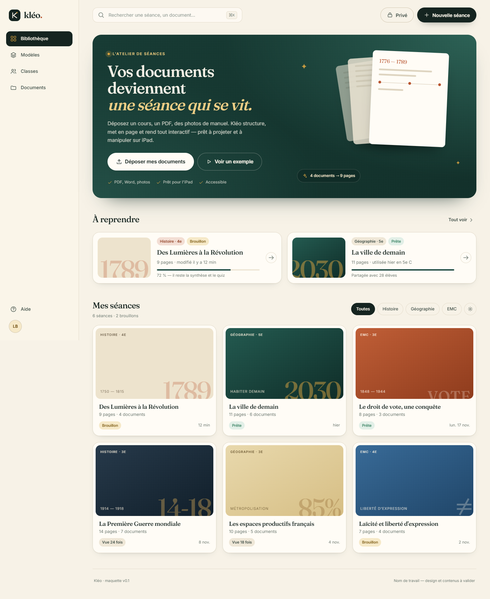
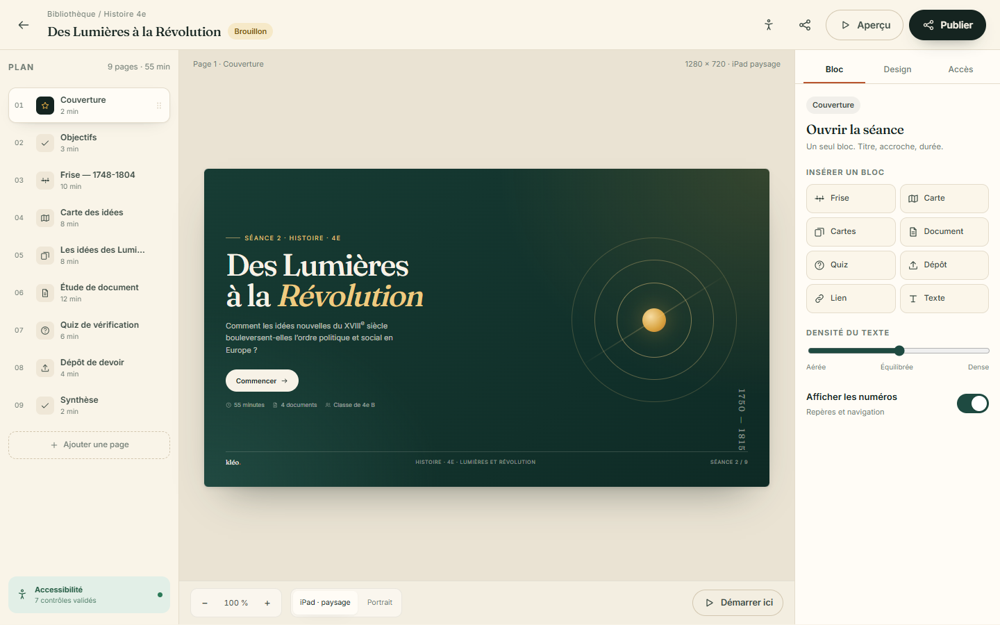
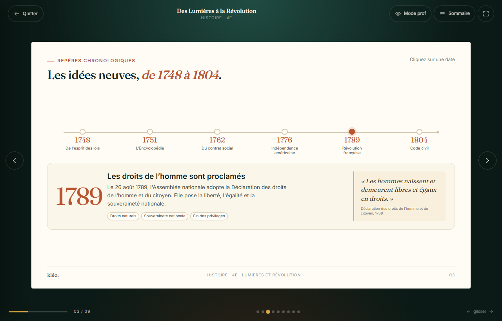
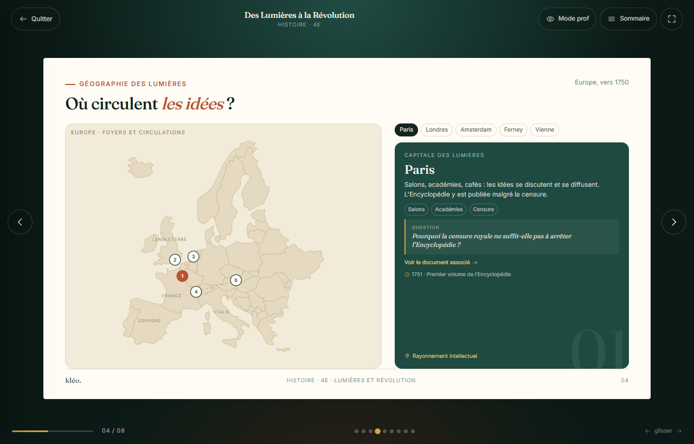
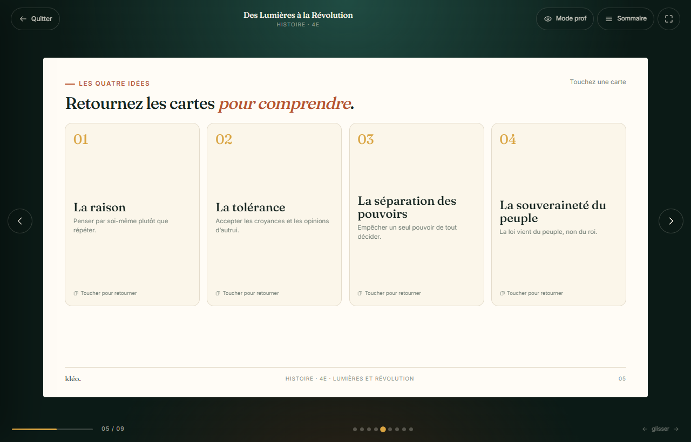
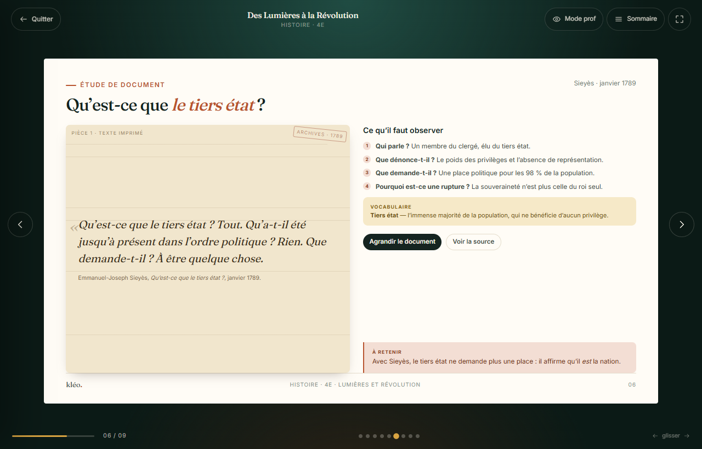
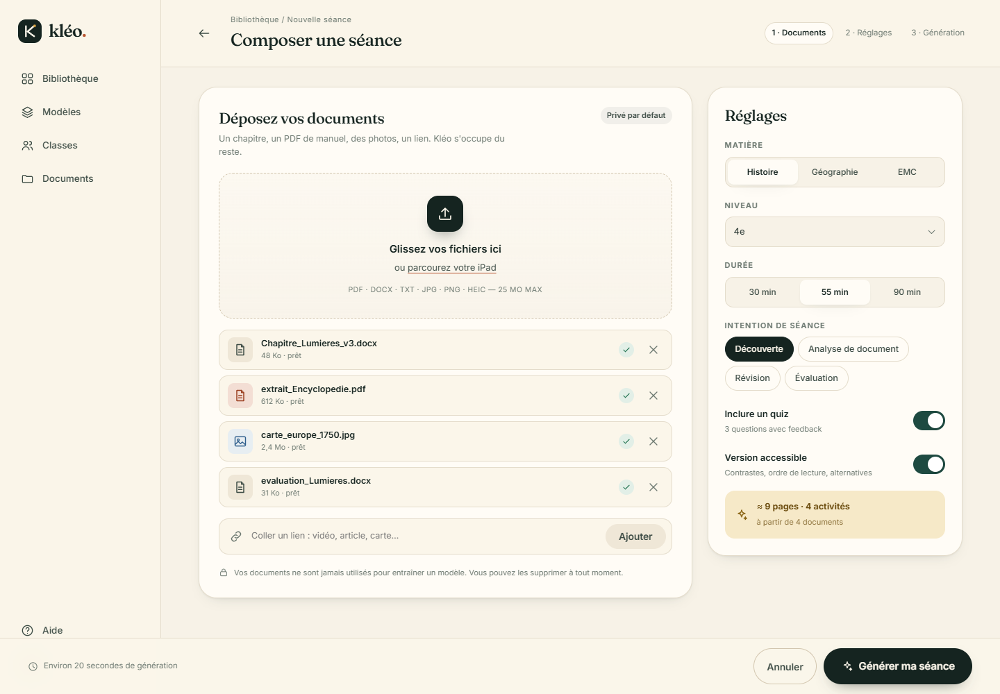
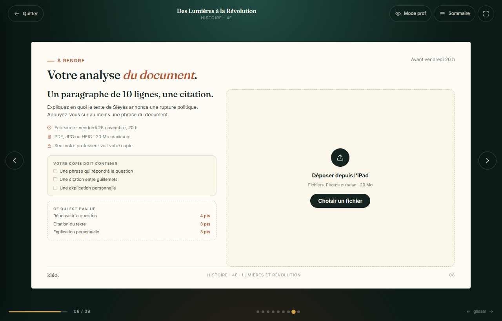

# Kléo — la fabrique de séances

> **Nom de travail.** Remplacer « Kléo » par le nom définitif se fait en une passe (`grep -ri kleo`).

Kléo transforme des documents de cours bruts — PDF, Word, photos, liens — en **séances interactives** prêtes à projeter et à manipuler sur iPad, pour l'histoire-géographie-EMC.

Le fond reste au professeur. La forme, la structure et l'interactivité sont prises en charge.

## Aperçu

| Bibliothèque | Éditeur |
| --- | --- |
|  |  |

| Frise interactive | Carte des idées |
| --- | --- |
|  |  |

| Cartes à retourner | Étude de document |
| --- | --- |
|  |  |

| Import | Dépôt de devoir |
| --- | --- |
|  |  |

D'autres captures sont dans [`docs/previews/`](docs/previews/) (iPad portrait, téléphone, quiz, synthèse).

## État du projet

| Élément | Statut |
| --- | --- |
| Recherche Genially (captures + analyse) | ✅ `docs/RECHERCHE-genially.md` |
| Spécification produit & pipeline IA | ✅ `docs/PRODUIT.md` |
| Maquette interactive (HTML/CSS/JS, sans build) | ✅ `mockup/` |
| Application réelle (Next.js, base, IA) | ⏳ prochaine étape |

## Voir la maquette

Aucune installation n'est nécessaire :

```bash
# à la racine du dépôt
npx serve mockup
```

Puis ouvrir l'URL affichée. Ou simplement double-cliquer sur `mockup/index.html`.

Parcours de démonstration :

1. **Bibliothèque** → « Voir un exemple » ouvre la séance terminée.
2. **Nouvelle séance** → déposer des fichiers (ou utiliser les fichiers déjà présents) → régler → **Générer**.
3. **Éditeur** → plan de pages, blocs, accessibilité → **Aperçu**.
4. **Mode séance** → frise cliquable, carte, cartes à retourner, document, quiz, dépôt de devoir.
5. **Publier** → lien de partage et QR code.

Navigation clavier dans le mode séance : `←` `→` `Échap`. Tactile : glisser horizontalement.

## Structure

```
docs/
  RECHERCHE-genially.md     analyse du site de référence + captures
  PRODUIT.md                spécification, blocs, pipeline IA, roadmap
  research/                 captures d'écran de Genially
  previews/                 captures de la maquette
  github-pages-workflow.yml modèle de workflow (nécessite le scope `workflow`)
mockup/
  index.html                écrans de l'application
  styles.css                design system + mode séance
  app.js                    état, routage, interactions, contenu de la séance
  assets/europe.svg         fond de carte (Natural Earth, domaine public)
.github/workflows/pages.yml déploiement GitHub Pages de la maquette
```

## La séance de démonstration

« **Des Lumières à la Révolution (1750–1815)** » — Histoire, 4e, 55 minutes, 9 pages :

couverture · objectifs · frise chronologique interactive · carte des idées · cartes à retourner · étude de document · quiz · dépôt de devoir · synthèse.

## Prochaines étapes

1. Valider la direction visuelle et le parcours de génération.
2. Passer la maquette en Next.js + TypeScript, avec un vrai import PDF/DOCX.
3. Brancher le moteur de structuration (LLM → JSON de séance) et l'éditeur.
4. Comptes, stockage, partage, export PDF/SCORM.
5. Tests en classe sur iPad, ajustements tactiles et accessibilité.

## Licence

Projet privé — tous droits réservés.
